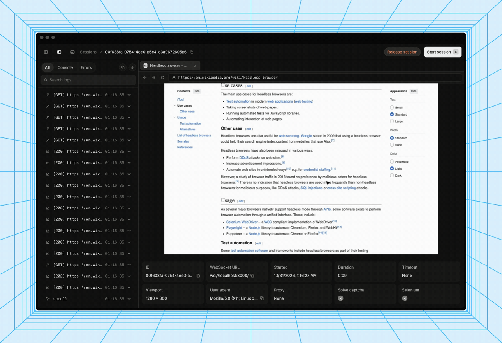

*Steel's live session viewer — frame from upstream's demo (`.github/assets/demo.gif`, steel-dev/steel-browser).*

# Deploy and Host

Steel Browser is the open-source browser API for AI agents and apps: a batteries-included headless Chromium behind a REST API, with sessions, scraping, screenshots, PDFs, and a raw Chrome DevTools Protocol WebSocket that Puppeteer and Playwright connect to directly. One-click deploy creates a single Steel service with a persistent volume for browser logs — and, unlike the official template, it is **API-key locked on every route**: the generated `STEEL_API_KEY` is required as an `Authorization: Bearer`, `x-api-key`, or `?apiKey=` credential, or once in a browser at `/login` to unlock the built-in UI. After deploy, open the public URL, log in with the key, and the live session viewer at `/ui` works immediately.

## About Hosting

Hosting Steel Browser on Railway keeps your browser automation on your own infrastructure instead of a SaaS. The deployment is a single always-on service: an nginx gateway on Railway's injected port requires the generated API key on every route except `GET /v1/health` (the platform probe), serves the `/login` page that stores the key as a cookie so the UI, Swagger docs, and DevTools debugger all work in the browser, and proxies `/devtools/` to the internal CDP debugger. The wrapper derives the public domain and TLS setting at boot, so the `websocketUrl` Steel hands back is a reachable `wss://` URL, and pins the image by manifest digest so a redeploy never silently pulls a new upstream build. The deploy form has one generated field and nothing to type.

## Why Deploy

- Private by default: upstream Steel ships no authentication at all — a public instance without a key is an open proxy anyone can drive on your bill and from your IP. This template closes that hole at the gateway, and refuses to start without a key.
- The UI actually works locked: the `/login` cookie keeps the live session viewer, Swagger docs, and DevTools debugger usable in the browser after one login — a header-only gateway would lock the UI out of its own API.
- Correct URLs out of the box: session websocket and debugger URLs are derived from the live Railway domain, not `localhost`.
- Small footprint for what it does: one service, no database, no companion — sessions are ephemeral and logs persist on a volume.
- Full browser control: sessions keep cookies and local storage across requests, with proxy, extension, stealth, and anti-detection support built in.

## Common Use Cases

- A browser backend for AI agents that browse, click, and read the live web.
- Headless scraping, screenshots, and PDF generation over a simple REST API.
- A remote CDP endpoint for Puppeteer or Playwright (`connect` over the returned WebSocket URL).
- A shared, authenticated browser for scripts and services running in the same Railway project.
- Watching a live session in the built-in viewer while an agent works.

## Dependencies for

- A single Steel Browser service (Node.js + bundled Chromium, no companion service).
- One persistent volume mounted at `/data` (browser logs at `/data/logs/browser-logs.duckdb`).
- Environment variables (condensed reference — full documentation in the repo README):

| Variable | Default | Description |
| --- | --- | --- |
| `STEEL_API_KEY` | `${{secret(32)}}` | API key for every route except `GET /v1/health`. Generated per deploy; send as `Authorization: Bearer`, `x-api-key`, or `?apiKey=`, or log in at `/login`. |
| `DOMAIN` | (derived from `RAILWAY_PUBLIC_DOMAIN` at boot) | Public domain Steel advertises in session and debugger URLs. |
| `USE_SSL` | `true` when a public domain exists | Makes Steel return `https://` / `wss://` URLs. |
| `LOG_STORAGE_ENABLED` | `true` | Enables Steel's DuckDB session-log storage. Baked into the image. |
| `LOG_STORAGE_PATH` | `/data/logs/browser-logs.duckdb` | Session logs on the volume. Baked into the image. |
| `PROXY_URL` | — | (Upstream, optional) Proxy browser traffic through, e.g. `user:pass@host:port`. |
| `CHROME_ARGS` | — | (Upstream, optional) Extra space-separated Chrome flags. |
| `DISABLE_CHROME_SANDBOX` | — | (Upstream, optional) Set to `true` only if Chromium cannot start in the container. |
| `DEFAULT_TIMEZONE` | — | (Upstream, optional) Timezone for browser sessions. |

### Deployment Dependencies

- Plan tier: Hobby is enough for a single session at a time; each Chromium session adds memory — a few hundred MB per session — so size up if you run many concurrent sessions.
- No companion database, no extra services. Sessions are ephemeral by design.
- The DevTools console debugger port (9223) is internal-only: Railway exposes a single public port per service, so the debugger is reached through the gateway as `/devtools/` instead.
